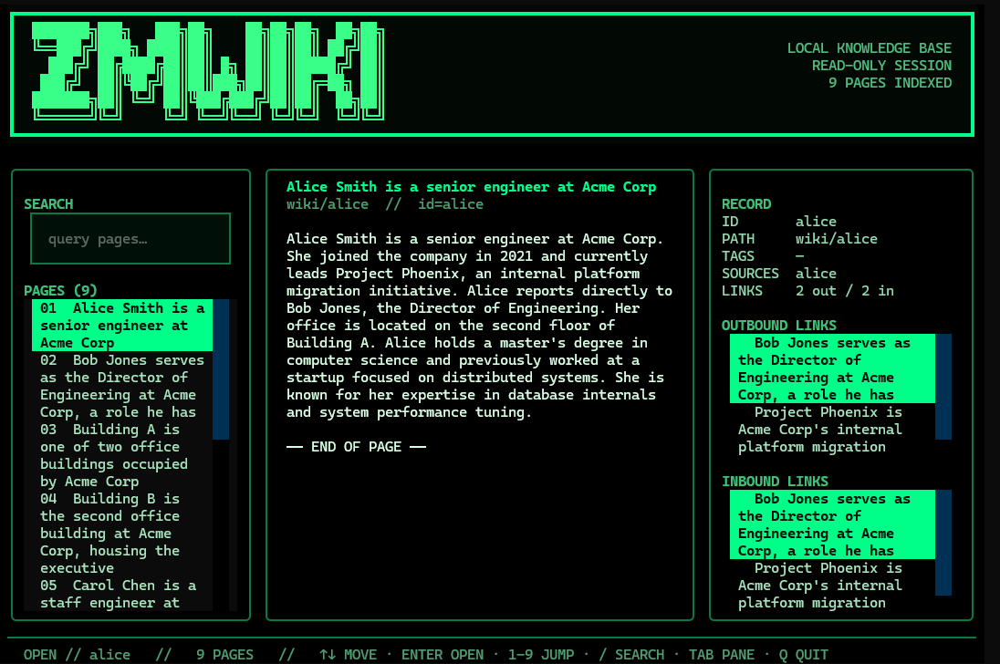

# ZMWiki

**Agent-native Wiki Knowledge System**

ZMWiki turns a document collection into an interlinked, agent-navigable wiki.
Each document compiles into a `WikiPage` with stable identity, structured
metadata, and verified bidirectional links. A `WikiAgent` searches, reads, and
follows links across pages to answer multi-hop questions — instead of relying on
a single retrieval pass over flat chunks.

ZMWiki builds on the **zmwiki deterministic retrieval & evaluation layer**
(lexical BM25, dense, hybrid, offline metrics). The RAG pipeline remains the
retrieval backbone; ZMWiki adds the wiki representation, compiler, agent, and
terminal UI on top.



## Features

### Wiki Knowledge Layer

- **WikiPage** — frozen dataclass with stable `page_id`, normalized `path`,
  `title`, `content`, `aliases`, `tags`, `sources`, and verified `links_to` /
  `links_from`
- **WikiIndex** — in-memory index with BM25 metadata + content search, path
  lookup, and bidirectional link consistency checking
- **wiki_search / wiki_read** — deterministic lexical retrieval (metadata weight
  2.0 + content weight 1.0 + exact title/alias bonuses), returning search
  candidates without content; `wiki_read` fetches full pages by path
- **WikiCompiler** — compiles raw documents into WikiPages via an OpenAI-compatible
  chat completions endpoint. Model-suggested links are stored as
  `candidate_links` (unverified), never written directly to `links_to`
- **Link Resolver** — deterministic candidate-link resolution: matches by
  `page_id` > normalized path > title > alias, with unique-match acceptance,
  unresolved / ambiguous / self-link reporting, and bidirectional link enforcement
- **WikiAgent** — multi-step retrieval agent with `search` / `read` /
  `follow_links` / `answer` action protocol. Evidence is strictly separated:
  answers can only cite pages that have actually been read. Budget control via
  `max_steps`, `search_top_k`, `max_consecutive_errors`, and duplicate-action
  deduplication
- **Retro Terminal UI** — read-only terminal browser with ASCII banner, three-pane
  layout (search + page list / content reader / metadata + links), fluorescent-green
  on black theme, keyboard-driven navigation

### Retrieval & Evaluation Backbone (zmwiki)

- Document ingestion (plain text, `.txt` files, directories)
- Fixed-size chunking
- Lexical (BM25) retrieval
- Dense (embedding) retrieval
- Hybrid retrieval (dense + lexical)
- Weighted score fusion / Reciprocal Rank Fusion (RRF)
- Deterministic reranking
- Optional real semantic embeddings (sentence-transformers)
- Optional Cross-Encoder reranking
- Optional query rewriting (`QueryRewriter`)
- Context building
- Optional answer generation (`Generator`; deterministic extractive or real LLM)
- Source attribution (`answer_with_sources()`)
- Offline retrieval evaluation: Hit Rate / Recall / Precision / MRR / MAP / NDCG
- Offline answer evaluation: lexical reference coverage, groundedness, citation coverage
- Claim-level attribution

## Architecture

```
Documents
   ↓
WikiCompiler (LLM-assisted) ──► WikiPage (candidate_links, unverified)
                                       ↓
                              Link Resolver (deterministic)
                                       ↓
                              WikiPage (verified links_to / links_from)
                                       ↓
                              WikiIndex (BM25 + path + link graph)
                                       ↓
              ┌────────────────────────┼────────────────────────┐
              ↓                        ↓                        ↓
        wiki_search              wiki_read              WikiAgent
        (BM25 candidates)        (full pages)           (multi-step:
                                                            search → read →
                                                            follow_links →
                                                            answer)
              │                        │                        │
              └────────────────────────┼────────────────────────┘
                                       ↓
                              Retro Terminal UI
                              (read-only browser)
```

The zmwiki retrieval pipeline (chunking → embedding → dense/lexical/hybrid
retrieval → fusion → reranking → context → generation → evaluation) remains
available as the baseline retrieval backbone and is used in the controlled
zmwiki-vs-ZMWiki comparison benchmark.

## Installation

Default install — deterministic, **zero ML dependencies, no model download,
no API key**:

```bash
pip install -e .
```

Development (adds pytest):

```bash
pip install -e ".[dev]"
```

Terminal UI (adds `textual`):

```bash
pip install -e ".[tui]"
```

Semantic (adds `sentence-transformers` for optional real-model features):

```bash
pip install -e ".[semantic]"
```

## 快速上手

> 以下是中文简明使用指南。英文完整版见下方 [Quick Start](#quick-start)。

### 这是什么

ZMWiki 是一个**只读的 Wiki 终端浏览器**。你给它一个包含 Wiki 页面的 JSON 文件，它就能在终端里以三栏布局（搜索 + 页面列表 / 正文阅读 / 元数据与链接）浏览和搜索。

仓库自带一个演示语料库（虚构的 Acme Corp 公司，9 篇文档），可以直接用来体验。

### 安装

```bash
# 克隆仓库后进入目录
cd zmwiki

# 安装（默认零依赖）
pip install -e .

# 安装终端 UI 依赖（必须，否则无法启动 TUI）
pip install -e ".[tui]"
```

### 启动

仓库已自带演示用的 workspace 文件，直接运行：

```bash
python -m zmwiki.tui --workspace benchmark/corpus/wiki_workspace.json
```

启动后你会看到：顶部 ZMWiki 绿色 ASCII 标题，左侧搜索框和页面列表，中间正文，右侧元数据和双向链接，底部状态栏和快捷键提示。

### 操作说明

| 按键 | 功能 |
|------|------|
| `/` | 进入搜索框（输入关键词后按回车搜索） |
| `↑` `↓` | 在列表中上下移动选中项 |
| `Enter` | 打开当前选中的页面 |
| `1`-`9` | 直接跳转到第 N 个页面 |
| `Tab` | 在搜索框 / 页面列表 / 出站链接 / 入站链接之间切换 |
| `Esc` | 清空搜索框，返回全部页面列表 |
| `Q` | 退出 |

### 搜索示例

演示语料库是虚构的 Acme Corp 公司数据，试试搜索这些关键词：

- `Alice` — 搜到 Alice Smith（高级工程师）
- `Phoenix` — 搜到 Project Phoenix（内部平台项目）
- `budget` — 搜到预算相关页面
- `Bob` — 搜到 Bob Jones（工程总监）
- `building` — 搜到办公楼页面

> **注意**：如果搜索显示 `NO MATCHES`，不是程序坏了，而是你输入的关键词不在当前语料库里。比如搜索"维基百科"当然搜不到，因为这个演示库是 Acme Corp 公司数据，不是维基百科。按 `Esc` 清空搜索即可返回全部页面。

### 用自己的文档

把你的纯文本文件放到一个目录，然后用以下脚本生成 workspace JSON：

```python
import sys, json
sys.path.insert(0, "benchmark")
from run_multihop_evaluation import load_documents, build_wiki_pages
pages = build_wiki_pages(load_documents())
json.dump({"version": 1, "pages": [p.to_dict() for p in pages]},
          open("my_wiki.json", "w", encoding="utf-8"), indent=2)
```

然后启动：`python -m zmwiki.tui --workspace my_wiki.json`

### 配置 LLM API（编译文档 / Agent 问答 / 评测时需要）

ZMWiki 的 TUI 浏览和搜索**不需要** API。只有以下三个功能需要调用大模型：

| 功能 | 用途 |
|------|------|
| **WikiCompiler** | 把原始文档编译成结构化的 WikiPage（标题、正文、候选链接） |
| **WikiAgent** | 多步检索问答（搜索 → 读页面 → 沿链接跳转 → 回答） |
| **对照评测** | `--live` 模式下用真实模型跑 WikiAgent 评测 |

#### 需要准备什么

ZMWiki 使用 **OpenAI 兼容接口**，任何支持 `POST /v1/chat/completions` 的服务都能用（OpenAI、DeepSeek、通义千问、智谱、Ollama、vLLM、LM Studio 等）。你需要三个信息：

1. **base_url** — API 地址，例如 `https://api.deepseek.com/v1`
2. **model** — 模型名称，例如 `deepseek-chat`
3. **api_key** — 密钥

#### 第一步：设置 API Key（不要写在代码或命令里）

```powershell
# Windows PowerShell（当前终端生效）
$env:ZMWIKI_API_KEY = "你的密钥"

# 或者设为用户级环境变量（永久生效，推荐）
[Environment]::SetEnvironmentVariable("ZMWIKI_API_KEY", "你的密钥", "User")
```

> 注意：环境变量名是 `ZMWIKI_API_KEY`，**不是** `OPENAI_API_KEY`。

#### 第二步：在代码中使用

**WikiCompiler（编译文档）：**

```python
from zmwiki.wiki.wiki_compiler import WikiCompiler

compiler = WikiCompiler(
    base_url="https://api.deepseek.com/v1",
    model="deepseek-chat",
    # api_key 不传时自动读取 ZMWIKI_API_KEY 环境变量
)
page = compiler.compile(document)  # Document → WikiPage
```

**WikiAgent（多步问答）：**

```python
from zmwiki.wiki.wiki_agent import WikiAgent

agent = WikiAgent(
    index,  # 你的 WikiIndex
    base_url="https://api.deepseek.com/v1",
    model="deepseek-chat",
    max_steps=8,  # 最多 8 步检索，每步一次 API 调用
)
result = agent.answer("谁负责 Project Phoenix？")
print(result.answer)
print(result.sources)  # 实际读取过的页面
```

**对照评测（命令行）：**

```powershell
python benchmark/run_multihop_evaluation.py `
  --live `
  --base-url https://api.deepseek.com/v1 `
  --model deepseek-chat `
  --limit 3 `
  --output results/trial.json
```

> 如果你的接口不需要密钥（比如本地 Ollama），加 `--allow-anonymous`。

#### 常见 endpoint 示例

| 服务 | base_url | model 示例 |
|------|----------|-----------|
| DeepSeek | `https://api.deepseek.com/v1` | `deepseek-chat` |
| OpenAI | `https://api.openai.com/v1` | `gpt-4o-mini` |
| 通义千问 | `https://dashscope.aliyuncs.com/compatible-mode/v1` | `qwen-plus` |
| 智谱 GLM | `https://open.bigmodel.cn/api/paas/v4` | `glm-4-flash` |
| 本地 Ollama | `http://localhost:11434/v1` | `llama3.1`（无需密钥，加 `--allow-anonymous`） |

#### 费用控制

- WikiAgent 每题最多 `max_steps`（默认 8）次 API 调用，每步一次，无重试、无额外请求
- 3 题受控试运行最多 3 × 8 = **24 次**调用
- 温度默认 `0.0`（确定性输出），超时默认 30 秒
- 非 2xx 响应或格式错误会立即停止该题，不会无限重试

---

## Quick Start

### Retro Terminal UI

```bash
python -m zmwiki.tui --workspace path/to/wiki.json
```

The workspace is a single JSON document:

```json
{
  "version": 1,
  "pages": [
    {"id": "page-1", "path": "topic/page-one", "title": "Page One", "content": "..."}
  ]
}
```

Keyboard shortcuts: `↑↓` move, `Enter` open, `1-9` jump, `/` search, `Esc`
clear search, `Tab` switch pane, `Q` quit.

### HTTP Server

```bash
python -m zmwiki.web.server --workspace path/to/wiki.json --port 8000
```

Then open `http://127.0.0.1:8000` in a browser. The server is read-only, uses
only the Python standard library (`http.server`), and serves the same workspace
JSON as the TUI. No extra dependencies required.

### Workspace JSON Format

The workspace is a single JSON document:

```json
{
  "version": 1,
  "pages": [
    {"id": "page-1", "path": "topic/page-one", "title": "Page One", "content": "...",
     "links_to": ["page-2"], "links_from": []}
  ]
}
```

Each page object maps directly to `WikiPage.to_dict()`. Required fields: `id`,
`path`, `title`, `content`. Optional: `aliases`, `tags`, `sources`, `links_to`,
`links_from`, `metadata`.

To build a workspace from plain-text source documents, use the benchmark helper:

```python
import sys, json
sys.path.insert(0, "benchmark")
from run_multihop_evaluation import load_documents, build_wiki_pages
pages = build_wiki_pages(load_documents())
json.dump({"version": 1, "pages": [p.to_dict() for p in pages]},
          open("wiki.json", "w", encoding="utf-8"), indent=2)
```

### Wiki Agent (Python API)

```python
from zmwiki.wiki.wiki_schema import WikiPage
from zmwiki.wiki.wiki_index import WikiIndex
from zmwiki.wiki.wiki_agent import WikiAgent

# Build an index (or load from a workspace JSON)
index = WikiIndex()
index.upsert(WikiPage(id="alice", path="people/alice", title="Alice Smith",
                       content="Alice leads engineering.", links_to=("project/phoenix",)))
index.upsert(WikiPage(id="project/phoenix", path="projects/phoenix",
                       title="Project Phoenix", content="Phoenix budget is 500k.",
                       links_from=("alice",)))

# Run the agent (requires a real LLM endpoint)
agent = WikiAgent(base_url="https://api.example.com/v1", model="your-model",
                  api_key="...", max_steps=8)
result = agent.answer("Who leads Project Phoenix?", index)
print(result.answer)
print(result.sources)   # pages actually read
print(result.status)    # answered / budget_exhausted / model_error / ...
```

### Deterministic RAG Pipeline (baseline)

```python
from zmwiki import (
    DeterministicRAGPipeline, DeterministicReranker, DeterministicEmbedder,
    DeterministicContextBuilder, DeterministicGenerator,
    DenseRetriever, LexicalRetriever, HybridRetriever,
    FixedSizeChunker, InMemoryVectorStore, InMemoryLexicalIndex,
    WeightedScoreFusion, PlainTextIngestor,
)

text = "zmwiki is a deterministic retrieval and ranking layer for RAG systems."
doc = PlainTextIngestor().ingest(document_id="quickstart-1", text=text)

embedder = DeterministicEmbedder(dimension=8)
vector_store = InMemoryVectorStore()
lexical_index = InMemoryLexicalIndex()

pipeline = DeterministicRAGPipeline(
    chunker=FixedSizeChunker(chunk_size=90),
    embedder=embedder,
    vector_store=vector_store,
    lexical_index=lexical_index,
    retriever=HybridRetriever(
        dense_retriever=DenseRetriever(embedder=embedder, store=vector_store),
        lexical_retriever=LexicalRetriever(index=lexical_index),
        fusion=WeightedScoreFusion(),
    ),
    reranker=DeterministicReranker(),
    context_builder=DeterministicContextBuilder(),
    generator=DeterministicGenerator(),
)
pipeline.ingest(doc)
results = pipeline.retrieve(query="retrieval", top_k=3)
```

## zmwiki vs ZMWiki Comparison Benchmark

A controlled multi-hop QA benchmark compares:

- **Baseline** — zmwiki single-pass hybrid retrieval + deterministic extractive generation
- **Experiment** — ZMWiki WikiAgent multi-step search / read / follow_links / answer

The benchmark includes 15 multi-hop questions (2-page, 3-page, single-page,
negative, and unanswerable cases) over 9 synthetic source documents, with
offline evaluation of answer accuracy, evidence recall, page recall, source
precision, multi-hop success, and efficiency metrics.

```bash
# Offline baseline only (no LLM, no network)
python benchmark/run_multihop_evaluation.py --output results/baseline.json

# Live experiment with real LLM (3-case controlled trial)
python benchmark/run_multihop_evaluation.py \
  --live --base-url https://api.example.com/v1 --model your-model \
  --limit 3 --output results/trial_3cases.json
```

API keys are read from `--api-key` or the `ZMWIKI_API_KEY` environment variable.
Anonymous endpoints require `--allow-anonymous`. Results are written to a
timestamped JSON file with per-case records, aggregate metrics, configuration,
git SHA, and source file hashes. A per-case checkpoint JSONL provides
incremental persistence.

## Retrieval Evaluation (zmwiki backbone)

Offline, deterministic retrieval evaluation over a frozen local benchmark (6
documents / 33 chunks / 8 queries):

| Strategy (`top_k=5`) | Recall@3 | Recall@5 | MRR@5 | NDCG@5 |
| --- | ---: | ---: | ---: | ---: |
| Dense | 0.0000 | 0.0000 | 0.0000 | 0.0000 |
| Hybrid + Weighted | 0.8125 | 0.8750 | 0.7500 | 0.7852 |
| Hybrid + RRF | 0.5000 | 0.7500 | 0.3271 | 0.4399 |
| Hybrid + Weighted + Rerank | 0.8750 | 0.8750 | 0.7500 | 0.7905 |

The bundled `DeterministicEmbedder` is a hash stand-in, not a model — the Dense
row measures plumbing rather than real dense retrieval. Full analysis in
[Retrieval Strategy Benchmark](docs/retrieval_strategy_benchmark.md).

## LLM Generation (optional)

`OpenAICompatibleGenerator` speaks HTTP through the standard library
(`urllib.request` + `json`), no vendor SDK. Any server exposing
`POST {base_url}/chat/completions` works: OpenAI, DeepSeek, Groq, Together,
vLLM, llama.cpp, Ollama, LM Studio, LiteLLM.

```python
from zmwiki import OpenAICompatibleGenerator

generator = OpenAICompatibleGenerator(
    base_url="https://api.example.com/v1",
    model="your-model-name",
    temperature=0.0,
    timeout=30.0,
)
```

API keys come from the `api_key` argument or `ZMWIKI_API_KEY` environment
variable. No key is ever written to a file, logged, or rendered by `repr`.

## Tests

```bash
python -m pytest -q
```

Wiki module tests: `273 passed` (WikiPage, WikiIndex, wiki_search/wiki_read,
WikiCompiler, WikiAgent, link resolver, multi-hop evaluation, TUI).

zmwiki core tests: `1281 passed, 5 skipped` (retrieval, ranking, generation,
evaluation, attribution).

## Project Scope

ZMWiki focuses on **wiki knowledge representation, compilation, agent navigation,
and evaluation**. The zmwiki backbone provides **retrieval, ranking, and offline
evaluation**. Not in scope:

- LLM answer generation as a standalone product (generation is a pluggable adapter)
- Streaming, retries/backoff, agent frameworks beyond WikiAgent
- Semantic query rewriting (HyDE, multi-query, expansion)
- MCP, memory, runtime serving, chat UI
- Faithfulness / RAGAS-style evaluation

## Documentation

- Architecture audit: [docs/zmwiki_architecture_audit.md](docs/zmwiki_architecture_audit.md)
- Design intent: [docs/architecture.md](docs/architecture.md)
- Retrieval strategy benchmark: [docs/retrieval_strategy_benchmark.md](docs/retrieval_strategy_benchmark.md)

## License

Proprietary.
