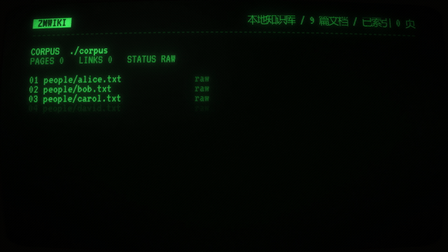

# ZMWiki

**Agent-native Wiki Knowledge System**

ZMWiki turns a document collection into an interlinked, agent-navigable wiki.
Each document compiles into a `WikiPage` with stable identity, structured
metadata, and verified bidirectional links. A `WikiAgent` searches, reads, and
follows links across pages to answer multi-hop questions — instead of relying on
a single retrieval pass over flat chunks.

ZMWiki bundles a deterministic retrieval & evaluation layer (the `zmwiki`
package: lexical BM25, dense, hybrid, offline metrics). The RAG pipeline remains
the retrieval backbone; ZMWiki adds the wiki representation, compiler, agent,
and terminal UI on top.

## 宣传片

<p align="center">
  <a href="https://github.com/lip20041219/ZMWIKI/raw/master/docs/videos/zmwiki-promo.mp4">
    
  </a>
</p>

<p align="center">
  <a href="https://github.com/lip20041219/ZMWIKI/raw/master/docs/videos/zmwiki-promo.mp4"><strong>▶ 观看完整宣传片（60 秒，MP4）</strong></a>
</p>


## Features

### Wiki Knowledge Layer

- **WikiPage** — frozen dataclass with a stable `id` (exposed as `page_id` by
  search and as page ids in agent diagnostics), normalized `path`, `title`,
  `content`, `aliases`, `tags`, `sources`, and verified `links_to` /
  `links_from`
- **WikiIndex** — in-memory index with BM25 metadata + content search, path
  lookup, and bidirectional link consistency checking
- **wiki_search / wiki_read** — deterministic lexical retrieval (metadata weight
  2.0 + content weight 1.0 + exact title/alias bonuses), returning search
  candidates without content; `wiki_read` fetches full pages by path
- **WikiCompiler** — compiles raw documents into WikiPages (returned as a
  `CompiledPage` with diagnostics) via an OpenAI-compatible chat completions
  endpoint. Model-suggested links are stored as `metadata["candidate_links"]`
  (unverified), never written directly to `links_to`
- **Link Resolver** — deterministic candidate-link resolution across page ids,
  normalized paths, titles, and aliases. Only a single unique page match is
  accepted; unresolved / ambiguous / self-links are reported, and bidirectional
  link consistency is enforced
- **WikiAgent** — multi-step retrieval agent with `search` / `read` /
  `follow_links` / `answer` action protocol. Evidence is strictly separated:
  answers can only cite pages that have actually been read. Budget control via
  `max_steps`, `search_top_k`, `max_consecutive_errors`, and duplicate-action
  deduplication
- **Retro Terminal UI** — terminal browser with ASCII banner, three-pane layout
  (search + page list / content reader / metadata + links), fluorescent-green on
  black theme, keyboard-driven navigation, local page create/edit/delete/undo,
  local `.txt` import with a source registry and sync, Wikipedia import, explicit
  workspace save, and agent answers with step-level diagnostics and source
  navigation

### Retrieval & Evaluation Backbone (zmwiki)

- Document ingestion (plain text, `.txt` files, directories)
- Fixed-size chunking
- Lexical (BM25) retrieval
- Dense (embedding) retrieval
- Hybrid retrieval (dense + lexical)
- Weighted score fusion / Reciprocal Rank Fusion (RRF)
- Deterministic reranking
- Optional real semantic embeddings (sentence-transformers)
- Optional Cross-Encoder reranking
- Optional query rewriting (`QueryRewriter`)
- Context building
- Optional answer generation (`Generator`; deterministic extractive or real LLM)
- Source attribution (`answer_with_sources()`)
- Offline retrieval evaluation: Hit Rate / Recall / Precision / MRR / MAP / NDCG
- Offline answer evaluation: lexical reference coverage, groundedness, citation coverage
- Claim-level attribution

## Architecture

```
Documents
   ↓
WikiCompiler (LLM-assisted) ──► WikiPage (candidate_links, unverified)
                                       ↓
                              Link Resolver (deterministic)
                                       ↓
                              WikiPage (verified links_to / links_from)
                                       ↓
                              WikiIndex (BM25 + path + link graph)
                                       ↓
              ┌────────────────────────┼────────────────────────┐
              ↓                        ↓                        ↓
        wiki_search              wiki_read              WikiAgent
        (BM25 candidates)        (full pages)           (multi-step:
                                                            search → read →
                                                            follow_links →
                                                            answer)
              │                        │                        │
              └────────────────────────┼────────────────────────┘
                                       ↓
                              Retro Terminal UI
                              (browse · edit · import · save)
```

The zmwiki retrieval pipeline (chunking → embedding → dense/lexical/hybrid
retrieval → fusion → reranking → context → generation → evaluation) remains
available as the baseline retrieval backbone and is used as the offline
baseline in the zmwiki-vs-ZMWiki comparison benchmark.

## Installation

Default install — library and `zmwiki` entry point, deterministic, **zero ML
dependencies, no model download, no API key** (the TUI itself needs the `tui`
extra below):

```bash
pip install -e .
```

Development (pytest + TUI tests; the full suite includes TUI tests):

```bash
pip install -e ".[dev,tui]"
```

Terminal UI (required to run the TUI; adds `textual`):

```bash
pip install -e ".[tui]"
```

Semantic (adds `sentence-transformers` for optional real-model features):

```bash
pip install -e ".[semantic]"
```

If `pip` points at a different interpreter, use `python -m pip` instead.

## 快速上手

> 以下是中文简明使用指南。英文完整版见下方 [Quick Start](#quick-start)。

### 这是什么

ZMWiki 是一个**本地 Wiki 终端浏览器与编辑器**。你给它一个包含 Wiki 页面的 JSON 文件，它就能在终端里以三栏布局（搜索 + 页面列表 / 正文阅读 / 元数据与链接）浏览、搜索和编辑页面；还可以从 Wikipedia 导入条目、把本地 `.txt` 文档编译成 Wiki 页面、撤销最近一次页面编辑、显式保存 workspace，配置模型后直接提问。

仓库自带一个演示语料库（虚构的 Acme Corp 公司，9 篇文档），可以直接用来体验。

### 安装

```bash
# 克隆仓库后进入目录
cd ZMWiki

# 只安装库（不含 TUI）
pip install -e .

# 或直接安装 TUI 版本（推荐首次体验；包含上述基础安装）
pip install -e ".[tui]"
```

> 以上命令在 Windows PowerShell、CMD 和常规 Python 环境通用。若 `pip` 指向其他解释器，改用 `python -m pip`。

### 启动

仓库已自带演示用的 workspace 文件，直接启动：

```bash
# 默认启动仓库自带的演示工作区
python -m zmwiki.tui

# 或显式指定工作区
python -m zmwiki.tui --workspace benchmark/corpus/wiki_workspace.json

# 创建全新的空工作区（目标文件必须不存在）
python -m zmwiki.tui --workspace my_wiki.json --create
```

安装 `.[tui]` 后，等价的 `zmwiki` 命令也可用，例如 `zmwiki --workspace my_wiki.json`。

> 默认工作区路径根据仓库源码位置解析；普通 wheel 安装或源码目录不完整时，请显式传入 `--workspace`。
>
> 默认工作区就是仓库里的演示文件，**只读保护**：按 `S` 不会写回。要保存自己的编辑，请先创建自己的工作区：`python -m zmwiki.tui --workspace my_wiki.json --create`。

启动后你会看到：顶部 ZMWiki 绿色 ASCII 标题，左侧搜索框和页面列表，中间正文，右侧元数据和双向链接，底部状态栏和快捷键提示。

### 操作说明

| 按键 | 功能 |
|------|------|
| `/` | 进入搜索框（输入关键词后按回车搜索） |
| `↑` `↓` | 在列表中上下移动选中项 |
| `Enter` | 打开当前选中的页面 |
| `1`-`9` | 直接跳转到第 N 个页面 |
| `Tab` | 在搜索框、页面列表、Wikipedia 搜索、提问框、出站/入站链接之间循环切换 |
| `N` | 新建页面（编辑器中 `Ctrl+S` 保存、`Esc` 取消） |
| `E` | 编辑当前页面（可修改路径、标题、标签、出链和正文） |
| `Ctrl+Z` | 撤销最近一次页面编辑（仅内存，需按 `S` 保存；导入/删除不可撤销） |
| `D` | 删除当前页面（按两次确认，自动清理双向链接） |
| `Esc` | 清空输入框；取消 Wikipedia 预览或页面编辑；返回页面列表 |
| `W` | 搜索 Wikipedia（回车列出结果，再回车阅读条目） |
| `I` | 导入当前预览的 Wikipedia 条目到内存 |
| `L` | 导入本地 `.txt` 文档（需 `--base-url` 和 `--model`；编译后自动保存） |
| `U` | 源同步：清理源文件已删除的受管页面（手工页面不会删除） |
| `S` | 保存 workspace（文件已存在时需按两次确认覆盖；演示工作区只读） |
| `Ctrl+S` | 主界面保存 workspace；页面编辑器中保存当前页面 |
| `A` | 向本地 Wiki 提问（启动时需带 `--base-url` 和 `--model`） |
| `Q` | 退出 |

### 搜索示例

演示语料库是虚构的 Acme Corp 公司数据，试试搜索这些关键词：

- `Alice` — 搜到 Alice Smith（高级工程师）
- `Phoenix` — 搜到 Project Phoenix（内部平台项目）
- `budget` — 搜到预算相关页面
- `Bob` — 搜到 Bob Jones（工程总监）
- `building` — 搜到办公楼页面

> **注意**：如果搜索显示“无匹配结果”，不是程序坏了，而是你输入的关键词不在当前语料库里。比如搜索“维基百科”当然搜不到，因为这个演示库是 Acme Corp 公司数据，不是维基百科。按 `Esc` 清空搜索即可返回全部页面。

### 导入本地文档（.txt）

本地导入会把纯文本编译成结构化 Wiki 页面（标题、正文、候选链接），适合把手头笔记接进现有知识库。

1. 启动时带上模型配置（编译器需要 OpenAI 兼容接口）：

```bash
python -m zmwiki.tui --workspace my_wiki.json --base-url https://api.deepseek.com/v1 --model deepseek-chat
```

2. 按 `L`，输入 UTF-8 `.txt` 文件路径并回车。编译完成后页面立即加入列表并**自动保存**到当前 workspace（这一步不需要再按 `S`）。
3. 再次导入同一文件会原地更新该页面。文件重命名但内容未变、且原路径已不存在时，也会复用原页面，不会新建重复页。
4. 源文件被移动或删除后，按 `U` 执行源同步：只清理由该源文件生成、且来源可确认的页面；手工新建的页面和源文件仍存在的页面不受影响。

仅支持 UTF-8 `.txt`。启动时未提供 `--base-url` / `--model` 时，按 `L` 会提示“本地导入不可用”；浏览、搜索、手工编辑和保存不需要模型。

若当前打开的是仓库演示工作区（只读），导入的页面只留在内存、不会写回演示文件；请先用 `--create` 创建自己的工作区。

### 从 Wikipedia 导入并提问

1. 按 `W`，输入主题（例如 `Alan Turing`），回车列出搜索结果。
2. 再按回车阅读当前条目；预览完成后按 `I` 导入到内存。
3. 按 `S` 保存 workspace。文件已存在时，第一次 `S` 只提示覆盖，再按一次才写入。
4. 提问需要模型配置（见下一节）。启动时带上参数：

```bash
python -m zmwiki.tui --workspace my_wiki.json --base-url https://api.deepseek.com/v1 --model deepseek-chat
```

按 `A`，输入问题并回车。没有配置模型时，提交问题后会显示“问答不可用 / 请以 --base-url 和 --model 启动”。

### 适用规模与模型要求

- 当前演示库为 9 页 / 约 9 KB。workspace 有 10 MiB 上限；按约 120 KB/页估算，约可容纳 **80 页**。
- 加载会随页数明显变慢，因为每次导入/加载都会重建 BM25。公开演示建议保持在几十页以内，更大规模请拆分 workspace。
- 真实问答和本地 `.txt` 编译导入需要可访问的 **OpenAI 兼容接口**：启动时提供 `--base-url` 和 `--model`，密钥用环境变量 `ZMWIKI_API_KEY`（或 `--api-key`）。未配置时只影响 `A` 提问和 `L` 本地导入；浏览、搜索、编辑、Wikipedia 导入和保存仍可用；仓库不内置本地模型。

### 用自己的文档

把你的纯文本文件放到一个目录，然后用以下脚本生成 workspace JSON：

```python
import json
from pathlib import Path

from zmwiki.wiki.wiki_schema import WikiPage

source_dir = Path("my_docs")
pages = [
    WikiPage(
        id=path.stem,
        path=f"docs/{path.stem}",
        title=path.stem.replace("_", " ").replace("-", " ").title(),
        content=path.read_text(encoding="utf-8"),
    )
    for path in sorted(source_dir.glob("*.txt"))
]
Path("my_wiki.json").write_text(
    json.dumps(
        {"version": 1, "pages": [page.to_dict() for page in pages]},
        ensure_ascii=False,
        indent=2,
    ),
    encoding="utf-8",
)
```

然后启动：`python -m zmwiki.tui --workspace my_wiki.json`

> 脚本会写入/覆盖同名的 `my_wiki.json`；如果已有工作区，请先改用其他文件名。

如果需要自动生成页面间链接，可在此基础上使用 `WikiCompiler` 和链接解析器；上面的脚本只创建互不链接的页面。用 TUI 的本地导入（`L`）导入文档后，workspace 会自动多出可选的 `sources` 登记表（源文件路径 → 页面），用于重复导入、重命名识别和源同步；手写 workspace 时可以不写。

### 配置 LLM API（编译文档 / Agent 问答 / 评测时需要）

ZMWiki 的 TUI 浏览、搜索和页面编辑**不需要** API。需要调用大模型的功能主要如下：

| 功能 | 用途 |
|------|------|
| **WikiCompiler** | 把原始文档编译成结构化的 WikiPage（标题、正文、候选链接） |
| **WikiAgent** | 多步检索问答（搜索 → 读页面 → 沿链接跳转 → 回答） |
| **OpenAICompatibleGenerator** | 可选的通用 LLM 生成适配器（Python API） |
| **对照评测** | `--live` 模式下用真实模型跑 WikiAgent 评测 |

#### 需要准备什么

ZMWiki 使用 **OpenAI 兼容接口**，任何支持 `POST /v1/chat/completions` 的服务都能用（OpenAI、DeepSeek、通义千问、智谱、Ollama、vLLM、LM Studio 等）。你需要三个信息：

1. **base_url** — API 地址，例如 `https://api.deepseek.com/v1`
2. **model** — 模型名称，例如 `deepseek-chat`
3. **api_key** — 密钥

#### 第一步：设置 API Key（用环境变量，不要写进源码或提交记录）

```powershell
# Windows PowerShell（当前终端生效）
$env:ZMWIKI_API_KEY = "你的密钥"

# 或者设为用户级环境变量（永久生效，推荐）
[Environment]::SetEnvironmentVariable("ZMWIKI_API_KEY", "你的密钥", "User")
```

```cmd
REM Windows CMD（当前窗口生效）
set ZMWIKI_API_KEY=你的密钥

REM 永久生效；需要重新打开终端
setx ZMWIKI_API_KEY "你的密钥"
```

> 注意：环境变量名是 `ZMWIKI_API_KEY`，**不是** `OPENAI_API_KEY`。不要把密钥写进 README、代码或提交记录。

#### 第二步：在代码中使用

**WikiCompiler（编译文档）：**

```python
from zmwiki.schema import Document
from zmwiki.wiki.wiki_compiler import WikiCompiler

document = Document(id="doc-1", content="ZMWiki is a local wiki.")
compiler = WikiCompiler(
    base_url="https://api.deepseek.com/v1",
    model="deepseek-chat",
    # api_key 不传时自动读取 ZMWIKI_API_KEY 环境变量
)
compiled = compiler.compile(document)  # Document → CompiledPage
page = compiled.page                    # WikiPage，可交给 WikiIndex.upsert()
```

**WikiAgent（多步问答）：**

```python
from zmwiki.wiki.wiki_agent import WikiAgent

agent = WikiAgent(
    index,  # 你的 WikiIndex
    base_url="https://api.deepseek.com/v1",
    model="deepseek-chat",
    max_steps=8,  # 最多 8 步检索，每步一次 API 调用
)
result = agent.answer("谁负责 Project Phoenix？")
print(result.answer)
print(result.sources)  # 实际读取并引用的页面路径
```

**对照评测（命令行）：**

```bash
python benchmark/run_multihop_evaluation.py --live --base-url https://api.deepseek.com/v1 --model deepseek-chat --limit 3 --output benchmark/results/trial.json
```

> 如果接口不需要密钥（比如本地 Ollama），benchmark 的 `--live` 模式需要额外加 `--allow-anonymous`。TUI 和 Python API 未设置密钥时不会发送 `Authorization` 请求头，可直接连接本地端点。

#### 常见 endpoint 示例

| 服务 | base_url | model 示例 |
|------|----------|-----------|
| DeepSeek | `https://api.deepseek.com/v1` | `deepseek-chat` |
| OpenAI | `https://api.openai.com/v1` | `gpt-4o-mini` |
| 通义千问 | `https://dashscope.aliyuncs.com/compatible-mode/v1` | `qwen-plus` |
| 智谱 GLM | `https://open.bigmodel.cn/api/paas/v4` | `glm-4-flash` |
| 本地 Ollama | `http://localhost:11434/v1` | `llama3.1`（无需密钥；benchmark `--live` 需加 `--allow-anonymous`） |

#### 费用控制

- WikiAgent 每题最多 `max_steps`（默认 8）次 API 调用，每步一次；总调用数不超过该上限
- 协议格式错误会带着纠错提示继续，连续 `max_consecutive_errors`（默认 2）次后停止，不会无限重试
- 非 2xx 响应会立即停止该题；没有网络级重试或退避
- 3 题受控试运行最多 3 × 8 = **24 次**调用
- 温度默认 `0.0`，超时默认 30 秒

---

## Quick Start

### Retro Terminal UI

```bash
# Bundled demo workspace (default)
python -m zmwiki.tui

# Explicit workspace
python -m zmwiki.tui --workspace path/to/wiki.json

# New empty workspace
python -m zmwiki.tui --workspace new.json --create
```

After installing `.[tui]`, the equivalent `zmwiki` command is available, e.g.
`zmwiki --workspace path/to/wiki.json`. The default workspace path assumes the
source checkout/editable install; pass `--workspace` for other installations.

The workspace is a single JSON document:

```json
{
  "version": 1,
  "pages": [
    {"id": "page-1", "path": "topic/page-one", "title": "Page One", "content": "..."}
  ]
}
```

Keyboard shortcuts: `↑↓` move, `Enter` open, `1-9` jump, `/` search, `N` new
page, `E` edit the current page, `Ctrl+Z` undo the last page edit (in memory;
press `S` to persist), `D` delete it (press twice; links are cleaned up), `W`
search Wikipedia, `A` ask, `I` import the previewed article, `L` import a local
`.txt` document (needs `--base-url`/`--model`; saves immediately), `U` sync
registered source files (removes only pages whose source file is gone), `S` save
the workspace (press twice to overwrite), `Ctrl+S` save the workspace from the
main view or the current page inside the editor, `Esc` clear search, `Tab`
switch pane, `Q` quit. Use `--create` to start a new empty workspace file.

The bundled demo workspace is read-only: `S` will not overwrite
`benchmark/corpus/wiki_workspace.json`. Create your own workspace with
`--create` to persist changes.

`A` requires an OpenAI-compatible endpoint (`--base-url`, `--model`), plus
`ZMWIKI_API_KEY` or `--api-key` when the endpoint needs authentication. Without
model configuration, browsing, page creation/editing, Wikipedia import and save
still work; local `.txt` import (`L`) and `A` require a model. The workspace
schema is capped at 10 MiB; at roughly 120 KB/page, that is about 80 pages.
Loading rebuilds BM25 and slows noticeably beyond a few dozen pages, so keep
demos small and split larger collections.

#### Local document import (`.txt`)

The TUI can compile local plain-text files into wiki pages. The compiler calls
an OpenAI-compatible endpoint, so start with a model configured:

```bash
python -m zmwiki.tui --workspace my_wiki.json \
  --base-url https://api.deepseek.com/v1 --model deepseek-chat
```

1. Press `L`, enter the path of a UTF-8 `.txt` file, and press `Enter`.
2. The compiled page appears immediately and is saved to the workspace
   automatically (no `S` needed).
3. Importing the same file again updates that page in place. A renamed file
   with unchanged content and a missing old path reuses the same page.
4. After deleting or moving a source file, press `U` to sync: only pages whose
   source is gone and whose provenance matches are removed. Manually created
   pages and pages whose source file still exists are kept.

Only UTF-8 `.txt` is supported. Without `--base-url` / `--model`, `L` reports
that local import is unavailable; browsing, search, editing and saving still
work. On the read-only demo workspace, imports stay in memory and are not
written back.

### HTTP Server

```bash
python -m zmwiki.web.server --workspace path/to/wiki.json --port 8000
```

Then open `http://127.0.0.1:8000` in a browser. The server is read-only, uses
only the Python standard library (`http.server`), and serves the same workspace
JSON as the TUI. No extra dependencies required.

### Workspace JSON Format

The workspace is a single JSON document:

```json
{
  "version": 1,
  "pages": [
    {"id": "page-1", "path": "topic/page-one", "title": "Page One", "content": "...",
     "links_to": ["page-2"], "links_from": []}
  ]
}
```

Each page object maps directly to `WikiPage.to_dict()`. Required fields: `id`,
`path`, `title`, `content`. Optional: `aliases`, `tags`, `description`,
`sources`, `links_to`, `links_from`, `metadata`.

The TUI also maintains an optional top-level `sources` registry after local
document imports (source path, page id, document id, content fingerprint). It is
written automatically and can be omitted when authoring a workspace by hand.

To regenerate the bundled demo workspace from its fixed corpus, use the
benchmark helper:

```python
import sys, json
sys.path.insert(0, "benchmark")
from run_multihop_evaluation import load_documents, build_wiki_pages
pages = build_wiki_pages(load_documents())
json.dump({"version": 1, "pages": [p.to_dict() for p in pages]},
          open("wiki.json", "w", encoding="utf-8"), indent=2)
```

This helper is pinned to the demo Acme corpus; for arbitrary text files, build
`WikiPage` objects directly as shown in the Chinese “用自己的文档” section.

### Wiki Agent (Python API)

```python
from zmwiki.wiki.wiki_schema import WikiPage
from zmwiki.wiki.wiki_index import WikiIndex
from zmwiki.wiki.wiki_agent import WikiAgent

# Build an index (or load from a workspace JSON)
index = WikiIndex()
index.upsert(WikiPage(id="alice", path="people/alice", title="Alice Smith",
                       content="Alice leads engineering.", links_to=("project/phoenix",)))
index.upsert(WikiPage(id="project/phoenix", path="projects/phoenix",
                       title="Project Phoenix", content="Phoenix budget is 500k.",
                       links_from=("alice",)))

# Run the agent (requires a real LLM endpoint)
# api_key is optional: ZMWIKI_API_KEY is read automatically when omitted.
agent = WikiAgent(index, base_url="https://api.example.com/v1",
                  model="your-model", max_steps=8)
result = agent.answer("Who leads Project Phoenix?")
print(result.answer)
print(result.sources)   # page paths actually read and cited
print(result.status)    # answered / insufficient_evidence / budget_exhausted / model_error / protocol_error
```

### Deterministic RAG Pipeline (baseline)

```python
from zmwiki import (
    DeterministicRAGPipeline, DeterministicReranker, DeterministicEmbedder,
    DeterministicContextBuilder, DeterministicGenerator,
    DenseRetriever, LexicalRetriever, HybridRetriever,
    FixedSizeChunker, InMemoryVectorStore, InMemoryLexicalIndex,
    WeightedScoreFusion, PlainTextIngestor,
)

text = "zmwiki is a deterministic retrieval and ranking layer for RAG systems."
doc = PlainTextIngestor().ingest(document_id="quickstart-1", text=text)

embedder = DeterministicEmbedder(dimension=8)
vector_store = InMemoryVectorStore()
lexical_index = InMemoryLexicalIndex()

pipeline = DeterministicRAGPipeline(
    chunker=FixedSizeChunker(chunk_size=90),
    embedder=embedder,
    vector_store=vector_store,
    lexical_index=lexical_index,
    retriever=HybridRetriever(
        dense_retriever=DenseRetriever(embedder=embedder, store=vector_store),
        lexical_retriever=LexicalRetriever(index=lexical_index),
        fusion=WeightedScoreFusion(),
    ),
    reranker=DeterministicReranker(),
    context_builder=DeterministicContextBuilder(),
    generator=DeterministicGenerator(),
)
pipeline.ingest(doc)
results = pipeline.retrieve(query="retrieval", top_k=3)
```

## zmwiki vs ZMWiki Comparison Benchmark

A 26-question wiki QA benchmark with multi-hop emphasis compares two
independently configured systems over the same corpus and dataset:

- **Baseline** — zmwiki single-pass hybrid retrieval + `DeterministicGenerator`
  (offline extractive generation, no LLM).
- **Experiment** — ZMWiki `WikiAgent` multi-step search / read / follow_links /
  answer, driven by a live OpenAI-compatible model.

This is **not a strictly controlled single-variable experiment**: the baseline
uses a deterministic offline generator while the experiment uses an online
DeepSeek model (`deepseek-chat` in the historical run).
Answer-quality differences can come from retrieval, evidence organization, or
the generator itself. Treat the two systems as independent results, not a
head-to-head semantic-accuracy comparison.

### Dataset and scoring

The dataset (`benchmark/datasets/multihop_wiki.json`, version 1.2) has 26 cases
over 9 synthetic Acme Corp documents: 22 answerable (5 single-hop, 17 two- or
three-hop) and 4 unanswerable (3 unanswerable + 1 false-premise).

Answer scoring is deterministic `keyword_group_match`, not semantic accuracy
and not an LLM judge: for answerable cases every keyword group must contain at
least one keyword in the normalized answer; unanswerable cases require a refusal
keyword and no fabrication keyword. Matching is case-insensitive after
punctuation stripping. A correct paraphrase can score 0 and a verbatim copy can
score 1. The fabrication guard is a lexical heuristic, so unanswerable cases
still need manual audit.

Metrics are **answer accuracy** (keyword-scored), **verified answer accuracy**
(answered with at least one cited source), **read evidence recall**
(`read_evidence_recall`, required pages actually read; for the baseline this is
its retrieved context set), legacy **access recall** (`evidence_recall`, which
also counts search candidates), **source precision**, **multi-hop success**, and
efficiency (steps / pages read). There is no separate "page recall" metric.

### Historical result (v1.2, live run)

The committed result file `benchmark/results/m4_3_1_live_20261027.json`
(2026-10-27) records a live run with dataset v1.2, `deepseek-chat`,
`max_steps=8`, and `link_source=auto` (the `--auto-links` path):

| System | Keyword answer accuracy | Verified | Read evidence recall* | Source precision | Multi-hop success* | Mean steps |
| --- | ---: | ---: | ---: | ---: | ---: | ---: |
| Offline baseline | 4/26 (15.4%) | 4/26 | 0.886 | 0.378 | 2/17 (11.8%) | 1.00 |
| Online WikiAgent | 26/26 (100%) | 26/26 | 1.000 | 0.783 | 17/17 (100%) | 3.27 |

\*Read evidence recall and multi-hop success are over answerable cases; source
precision is over all cases. The 26/26 is a **historical v1.2 keyword-scored
result**, not a general semantic-accuracy claim, and it is not reproduced by the
offline command below. The deterministic baseline was rerun offline for this
documentation update and again scored 4/26 (15.4%) on dataset v1.2; offline runs
do not execute WikiAgent and leave the experiment aggregate empty.

Benchmark links are hand-authored for this corpus (`_PAGE_LINKS` /
`_CANDIDATE_LINKS`), not produced by `WikiCompiler`; `--auto-links` runs the
real resolver over hand-authored candidate link titles. This remains a compiler
capability gap.

### Reproduce

```bash
# Offline: baseline only. No API, no network; WikiAgent is NOT executed.
# Choose a new output path: the script refuses to overwrite an existing file.
python benchmark/run_multihop_evaluation.py \
  --output benchmark/results/offline_baseline_local.json

# Online: calls a real OpenAI-compatible API (network + possibly cost).
# Requires --base-url/--model and a valid key (ZMWIKI_API_KEY or --api-key).
# Runs BOTH the offline baseline and the online WikiAgent.
python benchmark/run_multihop_evaluation.py --live --auto-links \
  --base-url https://api.deepseek.com/v1 --model deepseek-chat \
  --output benchmark/results/live_run_local.json
```

Add `--limit 3` for a 3-case smoke run. Anonymous endpoints (e.g. local Ollama)
need `--allow-anonymous` for `--live`. Results are written only to a new JSON
file, with per-case records, aggregate metrics, configuration, git SHA, and
source file hashes. Live runs also write a per-case `*.checkpoint.jsonl` beside
the output and refuse to append to a stale checkpoint.

In this benchmark section, lowercase `zmwiki` refers to the retrieval/evaluation
package and backbone; `ZMWiki` refers to the wiki system built on top of it.

## Retrieval Evaluation (zmwiki backbone)

Offline, deterministic retrieval evaluation over a frozen local benchmark (6
documents / 33 chunks / 8 queries):

| Strategy (`top_k=5`) | Recall@3 | Recall@5 | MRR@5 | NDCG@5 |
| --- | ---: | ---: | ---: | ---: |
| Dense | 0.0000 | 0.0000 | 0.0000 | 0.0000 |
| Hybrid + Weighted | 0.8125 | 0.8750 | 0.7500 | 0.7852 |
| Hybrid + RRF | 0.5000 | 0.7500 | 0.3271 | 0.4399 |
| Hybrid + Weighted + Rerank | 0.8750 | 0.8750 | 0.7500 | 0.7905 |

The bundled `DeterministicEmbedder` is a hash stand-in, not a model — the Dense
row measures plumbing rather than real dense retrieval. Full analysis in
[Retrieval Strategy Benchmark](docs/retrieval_strategy_benchmark.md).

## LLM Generation (optional)

`OpenAICompatibleGenerator` speaks HTTP through the standard library
(`urllib.request` + `json`), no vendor SDK. Any server exposing
`POST {base_url}/chat/completions` works: OpenAI, DeepSeek, Groq, Together,
vLLM, llama.cpp, Ollama, LM Studio, LiteLLM.

```python
from zmwiki import OpenAICompatibleGenerator

generator = OpenAICompatibleGenerator(
    base_url="https://api.example.com/v1",
    model="your-model-name",
    temperature=0.0,
    timeout=30.0,
)
```

API keys come from the `api_key` argument or `ZMWIKI_API_KEY` environment
variable. No key is ever written to a file, logged, or rendered by `repr`.

## Tests

```bash
python -m pytest -q
```

The full suite includes TUI tests; install with
`pip install -e ".[dev,tui]"` (pytest + Textual) before running it.

Last verified locally: `1762 passed, 4 skipped` with Python 3.11.9 on Windows.
The current code commit also passes GitHub Actions (Ubuntu/Python 3.11). The
four skips are semantic integration tests gated behind environment variables,
not failures.

## Project Scope

ZMWiki focuses on **wiki knowledge representation, compilation, agent navigation,
and evaluation**. The zmwiki backbone provides **retrieval, ranking, and offline
evaluation**. Not in scope:

- LLM answer generation as a standalone product (generation is a pluggable adapter)
- Streaming, retries/backoff, agent frameworks beyond WikiAgent
- Semantic query-rewriting variants such as HyDE, multi-query, and expansion
  beyond the existing `QueryRewriter` hook
- MCP, memory, production runtime serving, chat UI
- Faithfulness / RAGAS-style evaluation

## Documentation

- Architecture audit: [docs/zmwiki_architecture_audit.md](docs/zmwiki_architecture_audit.md)
- Design intent: [docs/architecture.md](docs/architecture.md)
- Retrieval strategy benchmark: [docs/retrieval_strategy_benchmark.md](docs/retrieval_strategy_benchmark.md)

## License

MIT License. See [LICENSE](LICENSE).
